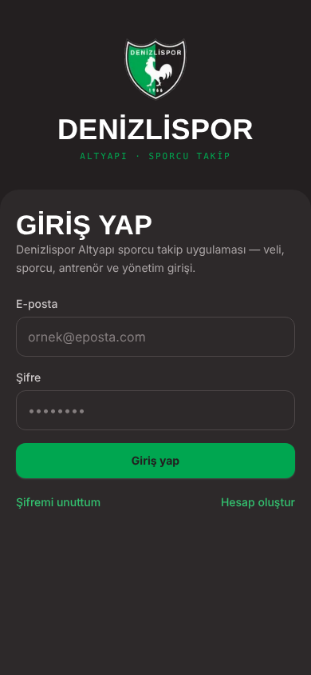
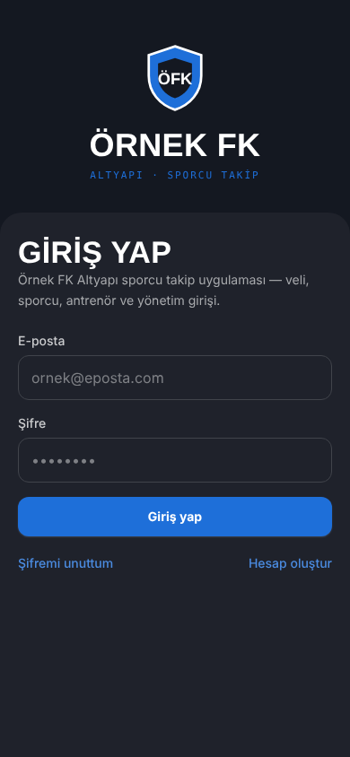
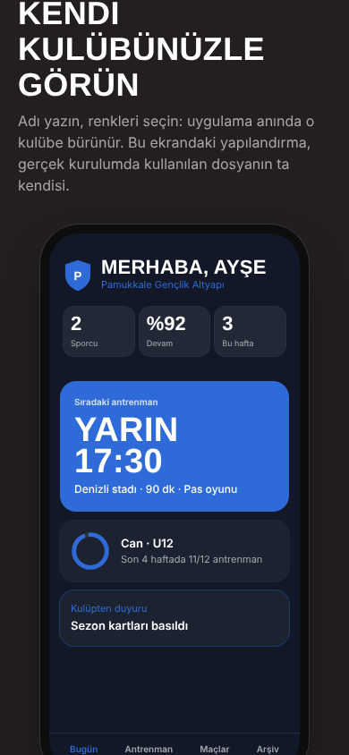

# Yuva — futbol altyapıları için sporcu takip platformu

Antrenman, yoklama, gelişim, aidat ve şeffaf kasa tek uygulamada. Veli telefonundan görür,
antrenör saha kenarında girer, kulüp hesap verir. Her kulübe **kendi adı, arması ve renkleriyle,
kendi veritabanında** kurulan beyaz etiketli bir SaaS.

İlk kurulum ve "altın kopya": **Denizlispor Altyapı** — https://denizlisporaltyapi.vercel.app
Ürün tanıtımı ve canlı kulüp kurulum sihirbazı: [`/urun`](https://denizlisporaltyapi.vercel.app/urun)

| Denizlispor kurulumu | Aynı kod, başka kulüp | Kurulum sihirbazı |
|---|---|---|
|  |  |  |

## Ne yapıyor?

**Veli / sporcu** — sıradaki antrenman, devam oranı, antrenör notları, **Sporcu Pasaportu**
(ilk antrenmandan ilk gole yolculuk), basılabilir **Sezon Kartı** ve **Sezon Karnesi**,
aidat borcu ve dekontla ödeme bildirimi, kulübün **şeffaf kasası**, duyurular,
antrenman ve maçları telefon takvimine ekleme (.ics).

**Antrenör** — antrenman günlüğü, isme dokunarak yoklama, beş alanda dönem değerlendirmesi,
boy / kilo / sprint ölçümleri ve gelişim eğrileri, maç kadrosu ve dakikalar, duyuru yayınlama
ve okunma takibi.

**Yönetim** — sporcu kayıt ve onay, kendiliğinden aidat tahakkuku, ödeme onayı, kasa hareketleri,
rol atama ve yetki talepleri, silinen ve değiştirilen her kaydın arşivi, **Altyapı Arşivi**
(sezon sezon mühürlenen kulüp hafızası), Excel'e dışa aktarım.

**Güven** — satır düzeyinde yetki (RLS), sporcu hesabı para ekranlarını hiç görmez,
KVKK aydınlatma metni + sürümlü açık rıza kaydı, güvenlik başlıkları, sağlık ucu.

## Teknoloji

- **Next.js 15** (App Router, Server Components, Server Actions) · **React 19** · **TypeScript** (strict)
- **Supabase** — Postgres, Auth, Storage; tüm erişim RLS politikaları ve `security definer` fonksiyonlarla
- **Tailwind CSS** — renkler CSS değişkeni; kulübün paleti çalışma anında kök stile yazılır
- **Vercel** — kulüp başına ayrı proje, bölge kulübün veritabanıyla aynı
- **PWA** — ana ekrana eklenir, kulübün arması simge olur
- Bağımlılıksız SVG grafikler; çalışma zamanında yalnızca 5 paket

## Mimari kararlar

- **Kulüp başına ayrı veritabanı, tek kod tabanı.** Çocuk verisi kulüpler arasında asla karışmaz;
  her kulüp KVKK'da kendi veri sorumlusudur; ayrılan kulübün verisi tek parça devredilir.
  Ayrıntı: [docs/MIMARI.md](docs/MIMARI.md).
- **Beyaz etiket yapılandırmayla.** Kodda kulüp adı, rengi, arması veya alan adı yoktur;
  hepsi [`src/kulup/kulupler/<kod>.json`](src/kulup/kulupler) dosyasından gelir ve
  `NEXT_PUBLIC_KULUP` ile seçilir. Ana renkten koyu tema paleti ve okunur yazı rengi türetilir.
- **Veritabanı kilidi.** Kulübün veritabanı proje kodu yapılandırmada sabittir; ona uymayan
  ortam değişkeni yok sayılır (yanlış veritabanına bağlanma riski sıfır).
- **Önce kod, sonra şema.** Yeni tabloya dayanan ekranlar, göç uygulanana kadar sessizce gizlenir
  (`src/lib/ozellik.ts`); canlı hiçbir zaman şema beklerken bozulmaz.
- **Arşiv kuralı.** Antrenör düzenler, yalnızca yönetim siler; her değişikliğin öncesi
  `spor_kayit_gecmisi` tablosuna yazılır.

## Yerel geliştirme

```bash
npm install
cp .env.example .env.local   # isteğe bağlı; varsayılan kulüp denizlispor
npm run dev                  # http://localhost:3000
NEXT_PUBLIC_KULUP=ornek npm run dev   # aynı uygulama, başka kulüp
```

Kontroller: `npm run tipler` (TypeScript) · `npm run build`. Her gönderimde GitHub Actions ikisini de çalıştırır.

## Klasörler

```
src/
  kulup/              beyaz etiket: kulüp yapılandırmaları + palet türetme
  app/
    panel/            veli ve sporcu ekranları
    antrenor/         antrenör ekranları (yönetim de girer)
    yonetim/          kulüp yönetimi
    urun/             ürün tanıtımı + kurulum sihirbazı (herkese açık)
    kvkk/             aydınlatma metni ve rıza
    api/saglik/       çalışma süresi izleme ucu
  components/         ortak arayüz parçaları
  lib/                yetki, roller, takvim (.ics), CSV, sezon, duyuru
supabase/migrations/  şema göçleri
docs/                 mimari, yeni kulüp kurulumu, ekran görüntüleri
```

## Yeni kulüp

Beş adım; ayrıntı [docs/YENI_KULUP.md](docs/YENI_KULUP.md).
